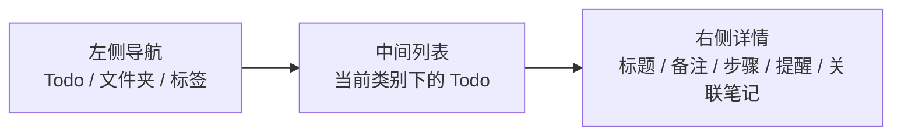
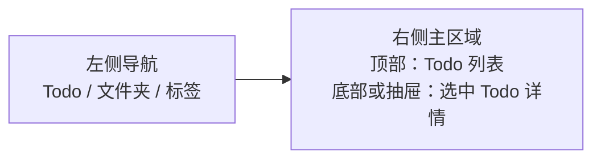

# Todo 功能计划

## 目标

在当前 Notebook 应用中新增一个独立的 Todo 区域。它显示在左侧普通文件夹上方，展开后包含 `今天`、`重要` 和用户自定义 Todo 类别。点击某个类别后，右侧显示该类别下的 Todo；每个 Todo 支持内容、步骤、和笔记互联，并在后续支持 macOS 系统通知提醒。

## 已确认决策

- Todo 要和笔记互联。
- 左侧结构采用：

```text
Todo
  今天
  重要
  工作
  生活
  项目 A

全部笔记
未分类
冲突
回收站
文件夹
  ...
加密文件夹
  ...
```

- Todo 类别包括智能类别和用户自定义类别。
- 智能类别第一版只做 `今天`、`重要`。
- 提醒使用 macOS 系统通知，复用现有 `NotificationManager` 思路。
- 数据和笔记放在同一套 SwiftData/BlockDocument 存储里，通过类型字段区分普通笔记和 Todo。
- **Todo 步骤使用独立 `TodoStepEntity`**，不复用 block 表（避免污染笔记富文本加载管线）。
- **阶段 3 之前先重构 `SidebarDestination`**，统一侧栏选择状态，再接入 Todo 模式。
- **删除 Todo 走软删除**（复用现有 `deletedAt` / 墓碑机制），不直接物理删除。

## 当前项目现状（已对照代码核验）

- 应用是 macOS SwiftUI + SwiftData 项目。
- 主界面使用 `NavigationSplitView`（`ContentView.swift:279-333`）：左侧导航、中间笔记列表、右侧编辑器。
- 当前已有笔记提醒字段：`BlockDocumentNoteEntity.reminderAt`、`recurrenceRule`（`BlockDocumentEntities.swift:123-124`）。
- 当前已有系统通知封装：`NotificationManager`（`NotificationManager.swift`）。
- 当前已有内部跳转能力：`NoteStore.selectedNoteId` 和 `selectedFolderForNavigation`（`Models.swift:22,24`）可让菜单栏入口切换到指定笔记。
- 当前未看到完整的笔记正文内链接协议，也就是说“从 Todo 点击跳到笔记”可以较快做；“在笔记正文里插入可点击 Todo/笔记链接并反向跳转”需要新增链接协议和点击处理。

### 通知相关事实（与初版计划描述有出入，需注意）

- **`NotificationManager` 的通知 ID 是原始 UUID 字符串**，不是 `note:\(id)`（`NotificationManager.swift:27`）。代码库中 `note:` 前缀只出现在 `ContentView+AIInput.swift:114` 作为 AI mention 的 markdown 链接 scheme，与系统通知无关。
  → 因此 Todo 通知 ID 直接继续用 todo 实体的 UUID 即可，note 和 todo 各自 UUID 唯一，天然隔离，无需引入 `note:`/`todo:` 前缀。
- **当前没有 `UNUserNotificationCenterDelegate`**，`userInfo["noteID"]` 设了但无人消费，点通知不会打开笔记。这是既存缺陷，本计划借 Todo 提醒一并补上。
- **`NotebookSettingView` 存在既存 bug**：`schedule(...)` 调用漏传 `recurrence`（`NotebookSettingView.swift:60-65`），从该入口保存的重复提醒会退化成一次性。提醒相关，顺手修。

### 迁移与存储事实

- `PersistenceController.currentStoreFormatVersion = 4`（`PersistenceController.swift:12`）。
- `NotebookSchemaMigrationPlan` 有 V1–V4 四个版本化 schema 和三个 lightweight stage（`NotebookSchemaMigrationPlan.swift:68-93`），但 **`ModelContainer` 创建时并未传入 `migrationPlan:`**（`PersistenceController.swift:72`），实际迁移由 `PersistenceMigrationSafety.prepareStoreForOpening` + SwiftData 自动 lightweight 完成。只要新字段都带默认值，lightweight 自动迁移即可生效；“加 V5 记录”主要是版本号/文档意义。
- 实施时需二选一：要么真正给 `ModelContainer` 接上 `migrationPlan:`，要么修正 `PersistenceController.swift:70-71` 的注释，避免以后误判当前迁移机制。
- 现有 V4 引入 `BlockDocumentNoteTagEntity` 连接表是先例：字符串字段 `tagIDs` 作权威格式 + 派生连接表做高效查询，历史数据由 `NoteStore.ensureNoteTagLinksBackfilled` 在 fetch 时兜底回填。`linkedNoteIDs` 可照此演进。

### 侧栏与选择状态事实

- `SidebarView`（`ContentView+Sidebar.swift:102-728`）目前顺序为：全部笔记 / 未分类 / 冲突 / 回收站 / 文件夹 / 加密文件夹 / 标签。
- 选择状态碎片化：`ContentView` 用 5 个变量表达侧栏目标——`selectedFolder: String`（普通文件夹靠**名字字符串**匹配）+ `selectedTagID: UUID?` + `selectedEncryptedFolderID: UUID?` + `isRecycleBinSelected: Bool` + `isConflictSelected: Bool`（`ContentView.swift:28-32`），无统一 enum。这是接入 Todo 模式前必须先重构的点。
- 折叠状态持久化：仅 `isFoldersExpanded`、`isTagsExpanded` 两个全局状态（`AppSettings.swift:61-69`），且**三处对齐**：UserDefaults + `NSUbiquitousKeyValueStore`（`AppSettings.swift:471-516`）+ `ConfigSyncManager`（`ConfigSyncManager.swift:41-42,400-405`）。新增 `isTodoExpanded` 必须三处都加。
- 加密文件夹展开是临时 `@State`，每次启动重置，需重新输密码。

### 笔记列表过滤事实

- 真正决定列表显示的不只是 `NoteStore.fetchData()`，而是 `ContentView.filteredNotes`（`ContentView.swift:38-109`，起点 `store.activeNotes`）。还有 `PopoverView.filteredNotes`（`PopoverView.swift:16-23`）和 `noteMatchesSearch`（`Models.swift:496-519`）。**这三处都要加 `itemType == "note"` 过滤**，否则 Todo 会漏进笔记列表/搜索/菜单栏。
- `uncategorizedNotesRow` 计数（`ContentView+Sidebar.swift:252-264`）也要加 `itemType == "note"`，否则无类别 Todo 会被算进未分类笔记数。
- 实施边界建议写死：`store.notes` 只放普通笔记，`store.todoItems` 只放 Todo。这样主界面、菜单栏、搜索等大部分 UI 天然不会混入 Todo；额外过滤只用于直接 SwiftData fetch 或未来兼容兜底。

### 同步事实

- SSH 同步：`SSHSyncManager`（`SSHSyncManager.swift`），`AutoSyncCoordinator`（`AutoSyncCoordinator.swift`）只走 SSH 自动同步（`AutoSyncCoordinator.swift:98`）。
- iCloud 同步：`iCloudSyncManager`（`iCloudSyncManager.swift`），note 记录序列化在 `iCloudSyncManager.swift:741-742,784-785` 附近，手动触发。
- 本地同步：`LocalSyncManager`（`LocalSyncManager.swift`），手动触发。
- 导入导出：`DataExportManager`（`DataExportManager.swift`），走 document migration package 格式。
- 软删除墓碑：`BlockDocumentDeletedNoteTombstoneEntity`（`BlockDocumentEntities.swift:373-391`）用于同步删除传播。物理删除会绕过墓碑，导致其他设备不删除——这也是 Todo 删除必须走软删除的原因。

## 右侧布局候选

### 方案 A：三栏式，沿用当前应用结构（已选定）



优点：
- 和当前 `NavigationSplitView` 最匹配。
- Todo 列表和详情同时可见。
- 更接近 Microsoft Todo、Things、OmniFocus 这类桌面任务工具。

代价：
- Todo 详情会占用右侧编辑区域；用户在 Todo 和笔记之间切换时，需要维护两套 detail view 状态。

### 方案 B：右侧一体式，列表优先（备选）



优点：
- 更简单，适合先做 MVP。
- 视觉上像在右侧打开一个 Todo 页面。
- 可以减少对当前三栏选择逻辑的改动。

代价：
- 长列表和复杂详情同时展示时会比较挤。
- 后续如果加入拖拽排序、批量操作、步骤编辑，交互空间不如方案 A。

**决定：采用方案 A。** 它更符合当前项目架构，也更适合长期维护。

## 数据模型设计

为了满足“和其他笔记形式一样，加一个类型区分”，扩展现有实体，而不是另建完全独立的 Todo 数据库。

### BlockDocumentNoteEntity 新增字段

```swift
var itemType: String = "note"        // note | todo
var todoDueAt: Date?                 // 截止时间，用于“今天”
var todoCompletedAt: Date?           // 非空表示已完成
var todoIsImportant: Bool = false    // 用于“重要”
var todoOrder: Int = 0               // 类别内排序
var linkedNoteIDs: String = ""       // JSON/UUID 列表，关联笔记
```

说明：
- 普通笔记统一 `itemType = "note"`。
- Todo 统一 `itemType = "todo"`。
- **不新增 `todoListID`**：Todo 的自定义类别就是 `folderType = "todoList"` 的文件夹，Todo 的类别直接用现有 `folderID` 指向该文件夹，与 note 指向 noteFolder 完全平行。避免 `todoListID` 与 `folderID` 语义重叠、查询分裂。
  - 列表过滤统一为 `itemType == "todo" && folderID == x`。
  - 无类别 Todo = `folderID == nil`。
- 现有笔记列表必须过滤掉 Todo（见上文“过滤层”三处）。
- Todo 列表只查询 `itemType == "todo"`。
- Todo 正文内容继续使用现有 block document 能力；备注、长文本、附件后续都可以复用笔记能力。
- `linkedNoteIDs` 演进路径同 `tagIDs`：MVP 用字符串字段；**未来若需反向查询（笔记→关联 Todo）或去重，应升级为 `BlockDocumentNoteLinkEntity` 连接表**，并在 fetch 时兜底回填，复用 V4 的先例。

### BlockDocumentFolderEntity 新增字段

```swift
var folderType: String = "noteFolder" // noteFolder | todoList
```

说明：
- 普通文件夹保持 `folderType = "noteFolder"`。
- 用户自定义 Todo 类别使用 `folderType = "todoList"`。
- `今天` 和 `重要` 不落库为文件夹，而是智能查询。
- 旧数据默认全部 `folderType = "noteFolder"`（lightweight 自动迁移）。
- `Folder` 内存模型也要带 `folderType`，并拆分加载结果：
  - `store.folders` 只包含 `noteFolder`，供普通笔记侧栏和 `FolderManagementView` 使用。
  - `store.todoLists` 只包含 `todoList`，供 Todo 侧栏和 Todo 类别管理使用。
  - 普通文件夹管理不能显示/管理 TodoList；TodoList 管理使用单独入口或限定版管理视图。

### TodoStepEntity（新增独立实体）

```swift
@Model
final class TodoStepEntity {
    @Attribute(.unique) var id: UUID = UUID()
    var noteID: UUID          // 所属 Todo 的 id（即 BlockDocumentNoteEntity.id）
    var libraryID: UUID
    var text: String          // 步骤文本（纯文本，不走 BlockDocumentTextSpanPayload 编码）
    var checked: Bool = false
    var order: Int = 0
    var createdAt: Date = Date()
}
```

说明：
- **不复用 `BlockDocumentBlockEntity`**。理由：block 表的 `textPayload` 是 `Data?`（JSON 编码的 `[BlockDocumentTextSpanPayload]`），不是纯字符串；且 note 的 block 会被 `fetchBlocks(noteID:)`（`Models.swift:322-336`）加载进编辑器渲染，混入 `kind = "todo_step"` 会在所有笔记正文加载路径强制加 `kind != "todo_step"` 过滤，耦合成本高。
- 独立实体结构简单、与笔记富文本模型正交，将来给步骤加独立提醒/负责人也容易。
- 级联删除：通过 `noteID` 显式删除（与 block/asset 现有“写入路径同步赋值 noteID”的模式一致）。
- 加入 `appSchema`（`PersistenceController.swift:14-25`）和 `NotebookSchemaV5.models`。

## 阶段 0：SidebarDestination 重构（前置）

在接入 Todo 导航之前，先把侧栏目标状态从 5 个碎片变量收敛为单一 enum：

```swift
enum SidebarDestination: Equatable, Hashable {
    case allNotes, unfiled, conflicts, recycleBin
    case noteFolder(UUID), encryptedFolder(UUID), tag(UUID)
    case todoToday, todoImportant, todoList(UUID)
}
```

任务：
- 在 `ContentView` 用 `@State var selectedDestination: SidebarDestination?` 替换 `selectedFolder`、`selectedTagID`、`selectedEncryptedFolderID`、`isRecycleBinSelected`、`isConflictSelected`。
- `SidebarView` 各 row 的 `isSelected` 改为与 `selectedDestination` 比对；普通文件夹由名字匹配改为 UUID 匹配（顺带消除名字匹配的歧义）。
- `filteredNotes` 的分支逻辑改为 `switch selectedDestination`。
- `PopoverView` 通过 `selectedNoteId`/`selectedFolderForNavigation` 跳转的桥接（`ContentView.swift:381,396-406`）改为写入 `selectedDestination`。
- 持久化：`lastSelectedFolder`/`lastSelectedNoteID` 的恢复逻辑适配新 enum（可序列化为枚举 case + 关联值）。

验收：现有笔记/文件夹/加密/标签/回收站/冲突导航全部正常，行为与重构前一致；`todoToday`/`todoImportant`/`todoList` case 暂不渲染但已就位。

建议把阶段 0 单独作为一个可回归节点或 PR。该阶段会同时触碰 `ContentView`、`SidebarView`、启动恢复、Popover 跳转、加密文件夹、标签筛选，完成并通过现有导航回归后，再开始 Todo 数据层。

## 笔记互联设计

第一阶段做内部互联：

- Todo 详情里增加“关联笔记”区域。
- 可以从现有笔记中选择一篇或多篇，写入 `linkedNoteIDs`。
- 点击关联笔记时，设置 `store.selectedNoteId`，并把 `selectedDestination` 切到对应笔记/文件夹。
- 普通笔记详情里可以显示“关联的 Todo”入口，点击后切到 Todo 视图。

第二阶段做正文链接：

- 新增内部链接协议，例如 `notebook://note/{noteID}` 和 `notebook://todo/{todoID}`。
- 富文本编辑器识别并处理内部链接点击。
- 支持从笔记正文插入“关联 Todo”链接，或从 Todo 备注插入“关联笔记”链接。

## 提醒设计

Todo 提醒复用系统通知。通知 request identifier 可以继续用实体原始 UUID 字符串，但通知 payload 建议从只写 `noteID` 升级为通用字段：

```swift
userInfo = [
    "itemID": id.uuidString,
    "itemType": "note" // note | todo
]
```

为兼容已调度的旧通知，delegate 处理时 fallback 读取 `userInfo["noteID"]`。

第一版字段：

- `reminderAt`：提醒时间（复用现有字段）。
- `recurrenceRule`：重复规则，沿用 `none`、`daily`、`weekly`、`monthly`（复用现有字段）。
- `todoDueAt`：截止时间，可和提醒时间不同。

行为：

- Todo 创建或编辑提醒后，调用通知调度。
- Todo 完成后，取消该 Todo 的未触发通知。
- 一次性提醒触发并过期后，可在下次加载时清理 `reminderAt`（复用 `Models.swift:542-551` 现有清理逻辑，扩展到 todo）。
- 重复提醒沿用笔记现有重复规则。

**通知点击跳转（MVP 必做，补既存缺陷）：**

- 实现 `UNUserNotificationCenterDelegate`，处理 `userNotificationCenter(_:didReceive:)`。
- 从 `userInfo["itemID"]` + `userInfo["itemType"]` 取目标；旧通知 fallback 读取 `userInfo["noteID"]`。
- 判断该实体 `itemType`：
  - `note` → 设置 `selectedNoteId` 并切到对应笔记视图。
  - `todo` → 设置 `selectedDestination` 为该 Todo 所在类别，并选中该 Todo。
- note 和 todo 共用同一套 delegate，增量很小。

## 主要开发任务

### 阶段 0：SidebarDestination 重构（见上）

### 阶段 1：数据层和迁移

- 给 `BlockDocumentNoteEntity` 增加 Todo 类型字段（`itemType`、`todoDueAt`、`todoCompletedAt`、`todoIsImportant`、`todoOrder`、`linkedNoteIDs`），全部带默认值。
- 给 `BlockDocumentFolderEntity` 增加 `folderType` 字段，默认 `"noteFolder"`。
- 新增 `TodoStepEntity`，加入 `appSchema`。
- 将 `PersistenceController.currentStoreFormatVersion` 从 4 bump 到 5。
- 在 `NotebookSchemaMigrationPlan` 增加 `NotebookSchemaV5`（models = V4.models + `TodoStepEntity.self`）和 V4→V5 lightweight stage。注意：当前 `ModelContainer` 未传 `migrationPlan:`，实际依赖自动 lightweight；保持新字段有默认值即可。
- 确保旧数据默认全部为普通笔记和普通文件夹。
- 更新 `NoteStore.fetchData()`，普通笔记加载只取 `itemType == "note"`（或旧数据无 `itemType` 字段时默认 note）。
- **过滤层三处对齐**（阶段 1 验收项）：
  - `ContentView.filteredNotes`（`ContentView.swift:38-109`）加 `itemType == "note"`。
  - `PopoverView.filteredNotes`（`PopoverView.swift:16-23`）加 `itemType == "note"`。
  - `noteMatchesSearch`（`Models.swift:496-519`）候选集排除 todo。
  - `uncategorizedNotesRow` 计数加 `itemType == "note"`。
- 新增 Todo 加载逻辑，提供 `todoItems` 和 `todoLists`。
- 明确内存集合边界：`store.notes` 只放普通笔记，`store.todoItems` 只放 Todo；`store.folders` 只放普通笔记文件夹，`store.todoLists` 只放 Todo 类别。
- **`AppSettings.isTodoExpanded` 三处对齐**：UserDefaults key `sidebar_todo_expanded` + iCloud key `icloud.sidebar_todo_expanded` + `ConfigSyncManager` 的 `AppSettingsData` 序列化。

### 阶段 2：Todo Store API

- 新增 `TodoItem`、`TodoList` 的内存模型。
- 新增创建、更新、完成、删除（软删除，置 `deletedAt`）、置顶重要、移动类别、排序 API。
- 新增智能查询：
  - `今天`：未完成（`todoCompletedAt == nil`），且 `todoDueAt` 是今天 OR `reminderAt` 是今天。
  - `重要`：未完成，且 `todoIsImportant == true`。
  - 自定义类别：`itemType == "todo" && folderID == 当前类别 ID && deletedAt == nil`。
- 已完成 Todo 默认从 `今天` 和 `重要` 隐藏（隐藏规则：`todoCompletedAt == nil`）。
- 步骤 CRUD（`TodoStepEntity`）：新增、完成、删除、排序（按 `order`）。

### 阶段 3：左侧导航

- 在 `SidebarView` 普通文件夹上方新增 Todo 区域。
- 增加 Todo 展开/收起状态 `isTodoExpanded`，持久化到 `AppSettings`（三处对齐）。
- 显示智能类别（`今天`、`重要`）和用户自定义类别（`folderType == "todoList"` 的文件夹）。
- 每个类别显示未完成数量。
- 点击 Todo 类别时，设置 `selectedDestination = .todoToday/.todoImportant/.todoList(id)`，进入 Todo 模式。
- 用户自定义 Todo 类别管理（新增/重命名/删除/排序）复用现有 `FolderManagementView` 思路，但限定 `folderType == "todoList"`。

### 阶段 4：右侧 Todo UI（方案 A）

- Todo 列表支持新增、完成、重要标记、删除（软删除）。
- Todo 详情支持标题、备注、步骤、截止时间、提醒时间、重复规则、关联笔记。
- 步骤支持新增、完成、删除、排序（操作 `TodoStepEntity`）。
- 空状态、无类别状态、无选中 Todo 状态需要有自然反馈。
- Todo 详情与笔记编辑器共用 `NavigationSplitView` 右侧 detail，通过 `selectedDestination` 切换显示哪个 detail view。

### 阶段 5：笔记互联

- Todo 详情支持添加/移除关联笔记（写入 `linkedNoteIDs`）。
- 点击关联笔记跳转到笔记（设 `selectedNoteId` + `selectedDestination`）。
- 笔记详情支持查看关联 Todo（反查 `linkedNoteIDs` 包含本笔记 id 的 todo；MVP 用全量扫描 + 缓存，未来升级连接表）。
- 点击关联 Todo 跳转到 Todo。
- 第二阶段再补正文链接协议和编辑器点击处理。

### 阶段 6：通知提醒

- 扩展 `NotificationManager`：新增 `schedule(todoID:...)` / `cancel(todoID:)`，或泛化为 `schedule(itemType:note/todo, id:...)`。ID 仍用原始 UUID。
- Todo 保存提醒时调度系统通知。
- Todo 完成/删除（软删除）时取消通知。
- 应用启动后检查 Todo 提醒，补调度未来提醒。
- 对已过期的一次性提醒做清理（扩展 `Models.swift:542-551` 到 todo）。
- **实现 `UNUserNotificationCenterDelegate`**，note/todo 点击统一跳转（见“提醒设计”）。
- **顺手修 `NotebookSettingView.swift:60-65` 漏传 `recurrence` 的 bug**。

### 阶段 7：同步、导入导出和测试

- 更新导入导出结构（`DataExportManager` 的 document migration package），包含 Todo 字段和 `TodoStepEntity`。
- 更新版本历史/快照结构，确保 Todo 步骤进入历史、同步 envelope 和冲突比对：
  - `VersionedNoteSnapshot` 增加 Todo step payload。
  - `BlockDocumentNoteVersionStore` 记录、恢复、导入、导出时包含 `TodoStepEntity`。
  - SSH/iCloud/Local 同步使用的序列化结构包含 steps，避免标题/备注同步了但步骤丢失。
- 更新同步逻辑，确保 Todo 类型不会丢字段：
  - `iCloudSyncManager`：note 记录序列化处（`iCloudSyncManager.swift:741-742,784-785` 附近）加新字段；`TodoStepEntity` 单独序列化。
  - `LocalSyncManager`：同步序列化加新字段。
  - `SSHSyncManager`：note push/pull 序列化加新字段。
  - `AutoSyncCoordinator` 只走 SSH（`AutoSyncCoordinator.swift:98`），即 Todo 自动跨设备仅对开了 SSH 的用户生效——在用户文档中注明。
- 软删除复用 `BlockDocumentDeletedNoteTombstoneEntity` 墓碑，确保删除能跨设备传播。
- 更新数据完整性检查（`BlockDocumentIntegrityValidator`），覆盖 Todo、TodoList、TodoStep。
- 增加单元测试：
  - 普通笔记不会出现在 Todo 列表。
  - Todo 不会出现在普通笔记列表（含 `filteredNotes`、`PopoverView.filteredNotes`、`noteMatchesSearch`、未分类计数）。
  - 智能类别查询正确（今天/重要/自定义）。
  - 完成 Todo 会取消通知且从今天/重要隐藏。
  - 软删除 Todo 会写墓碑且从列表消失。
  - 关联笔记跳转状态正确。
  - `TodoStepEntity` 级联删除正确。

## “还需要最终确认”的建议答案

- **右侧布局**：方案 A（已定）。
- **`今天` 范围**：截止时间和提醒时间任意一个为今天即算（`todoDueAt` 是今天 OR `reminderAt` 是今天），且未完成。
- **已完成智能类别**：MVP 不做独立入口，但已完成 Todo 仍需从 今天/重要 隐藏（`todoCompletedAt == nil`）。
- **重复任务**：MVP 只做重复提醒（复用 `recurrenceRule`），不做“完成后自动生成下一条”。后者涉及完成态与新生成的语义，单独设计。
- **删除方式**：软删除（复用 `deletedAt` + 墓碑），不直接物理删除。

## 推荐 MVP 范围

第一版建议交付：

- 阶段 0：SidebarDestination 重构。
- 左侧 Todo 区域。
- `今天`、`重要`、用户自定义类别。
- 创建/编辑/完成/删除（软删除）Todo。
- Todo 详情包含备注、步骤（`TodoStepEntity`）、截止时间、提醒时间、重要标记。
- Todo 关联笔记，并支持点击跳转到笔记。
- 系统通知提醒，**含点击跳转**（note/todo 共用 delegate）。

暂缓：

- 笔记正文内的 `notebook://` 可点击链接。
- 已完成智能类别独立入口。
- 重复任务自动生成下一次。
- Todo 回收站 UI（软删除已落地，仅回收站视图暂缓）。
- `linkedNoteIDs` 升级为 `BlockDocumentNoteLinkEntity` 连接表。
- 跨设备冲突合并的细粒度 Todo 步骤冲突处理。
